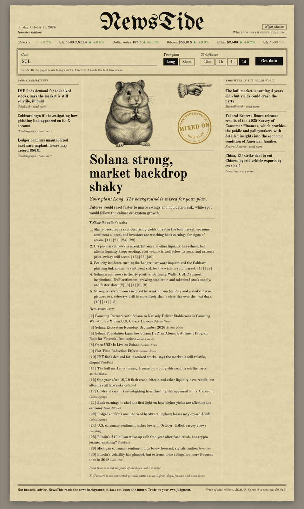

# NewsTide

A one-page news background indicator for crypto traders, printed as an old newspaper.

Before a trade you pick a coin, Long or Short, and your timeframe. NewsTide reads the news behind the chart (the coin's own official blog and forum, crypto news, the Federal Reserve and macro headlines) and prints one verdict: which way the news background points, and whether it favours your plan or goes against it.



Built for Devpost's **Build With AI: Basics** hackathon with the Devpost Learn Skill Pack. The planning documents live in [`devpost/`](devpost): [scope](devpost/scope.md), [PRD](devpost/prd.md), [technical spec](devpost/spec.md) and the [build checklist](devpost/checklist.md).

## Why

I trade spot and futures, mostly coins from the top 100. I can read a chart. What I keep getting wrong is the news: a rate decision, a yield spike, a hack at a wallet maker, a big partnership for the coin itself. It is too much to read before every trade, and how it adds up for one coin often goes differently from what I expected. NewsTide does that reading for me and gives one answer I can see at a glance, the way you glance at RSI.

## What you see

- **The pointing hand** shows where the news background points: up, down or sideways.
- **The ink stamp** says whether the background FAVOURS, is MIXED ON, or goes AGAINST your plan.
- **The headline** gives the verdict in a few words, for example "Growth expected for ETH" or "Neutral for now".
- **The page itself changes**: a Bull Edition (green paper, a smiling bull), a Bear Edition (red paper, a cheerful bear) or a Hamster Edition (yellowish paper, a hamster) when nothing is clear.
- **Show the editor's notes** opens the reasoning: a short cause-and-effect chain, each step citing the numbered dispatches it relies on, and the list of those dispatches. It is closed by default.
- **Price of this edition** shows what the analysis cost in model usage.

There are no percentages. A language model would have to invent them, so NewsTide does not show any.

## How it works

1. The page sends your coin, plan and timeframe to a small local server.
2. The server reads public RSS feeds. Below a 4h timeframe it keeps the last 24 hours of news; from 4h up it keeps the last two weeks. Each source takes turns, so one busy feed cannot crowd out the rest, and the coin's own official news always gets a place.
3. About 30 numbered dispatches go to Claude with one fixed answer shape (direction, plan fit, headline, a spot/futures note, and the chain with citations).
4. **An answer checker** runs before anything reaches the page: no percent signs, a headline of at most six words, the stamp must agree with the hand and your plan, and every step of the chain must cite a dispatch that was really collected. Broken rules are fixed and logged.
5. Each run is saved to `runs/` with every collected dispatch and the full chain, so any verdict can be traced back to its sources. One example is in [`runs/example-run.json`](runs/example-run.json).

If a feed is down, it is skipped and the page says so. If nothing usable comes back, the model is not called at all.

## Sources

| What | Where |
|---|---|
| Ethereum | [Ethereum Foundation Blog](https://blog.ethereum.org/feed.xml), [Ethereum Magicians forum](https://ethereum-magicians.org/latest.rss) |
| Solana | [Solana News](https://solana.com/news/rss.xml), [Solana forum](https://forum.solana.com/latest.rss) |
| Aave | [Aave governance forum](https://governance.aave.com/latest.rss) |
| Crypto news | [Cointelegraph](https://cointelegraph.com/rss), [CoinDesk](https://www.coindesk.com/arc/outboundfeeds/rss/) |
| Macro | [Federal Reserve press releases](https://www.federalreserve.gov/feeds/press_all.xml), [Investing](https://www.investing.com/rss/news_95.rss), [MarketWatch](https://feeds.content.dowjones.io/public/rss/mw_topstories) |
| Prices | [CoinGecko](https://docs.coingecko.com/) for Bitcoin and Ether, Yahoo Finance chart data (unofficial) for the S&P 500 and the dollar index |

None of the three coins has an open official Telegram channel, so the official blogs and forums are used instead. X is not connected yet: reading X costs money per post, so it is planned for later.

## Run it

You need Node.js 24 and an Anthropic API key.

```bash
npm install
cp .env.example .env    # then put your key after ANTHROPIC_API_KEY=
npm start               # open http://localhost:3000
```

Settings in `.env`:

- `MODEL`: `claude-haiku-5-5` for cheap tests (about $0.001 per analysis) or `claude-sonnet-5-5` for the final verdicts (about $0.011 per analysis).
- `DATA_MODE`: `sample` reads a saved snapshot of the feeds in `data/sample/` (repeatable, clearly labelled on the page); `live` reads the feeds now.

Other commands:

```bash
npm test             # answer checker rules and link safety
npm run snapshot     # save a fresh snapshot of every feed
npm run check:live   # read every feed now and test what happens when feeds fail
```

## Honest limits

- NewsTide reads the news background. It does not know the future, and it is not financial advice.
- The model is not deterministic. The same request on the same news can come back with a different verdict. That is one more reason the editor's notes are there: you can see what the verdict rests on.
- On a quiet weekend many verdicts are "Neutral for now". When the wider picture is mixed, the coin's own official news decides: on the saved Sunday snapshot Solana came out "Growth expected" (strong ecosystem news), while Ethereum and Aave stayed neutral.
- It runs only on your own machine. A public version would need accounts, limits and a server, so nobody else can spend the key's balance.
- Three coins for now. Adding a coin is one entry in `config/coins.json` with its official feeds.

## Later

- X as a source, through the user's own account.
- Any coin from the top 100.
- A TradingView indicator that reads the coin and timeframe from the chart you are looking at.
- A paid version for traders who do not want to deal with API keys: you pay once a month, everything runs on our side, and you see your balance (requests used, money spent, what is left). Traders who prefer can bring their own keys.

## Built with

Node.js 24, Express 5, fast-xml-parser, the Anthropic SDK (Claude Haiku 5.5 and Claude Sonnet 5.5, structured outputs), plain HTML, CSS and JavaScript. The paper texture and the engravings (bull, bear, hamster, pointing hand) were generated with Higgsfield. Fonts: UnifrakturMaguntia and Old Standard TT from Google Fonts.

Built with Claude Code following the Devpost Learn Skill Pack: start, scope, PRD, spec, build, ship.

## License

MIT, see [LICENSE](LICENSE).
